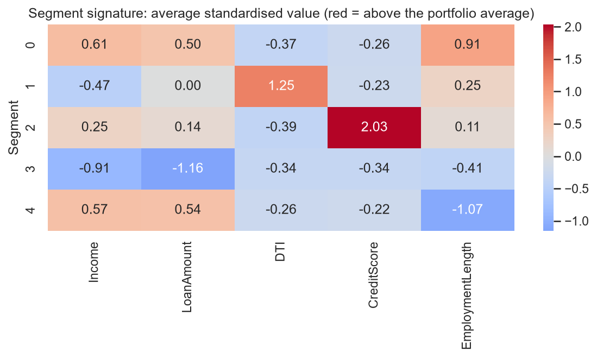
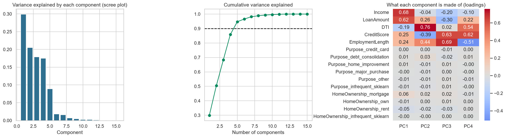
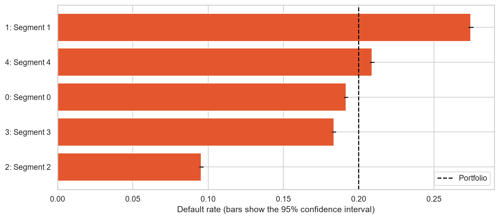
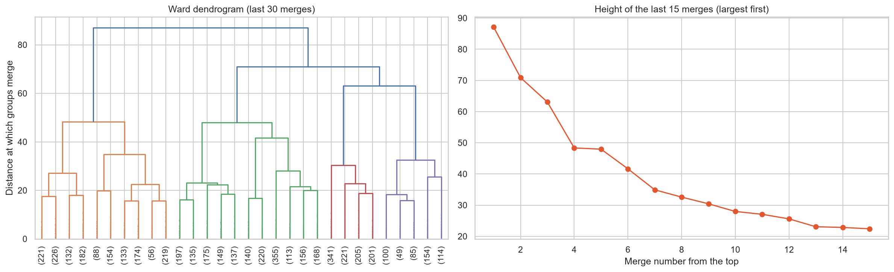
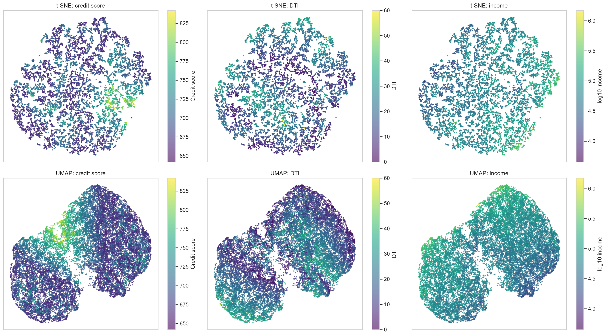
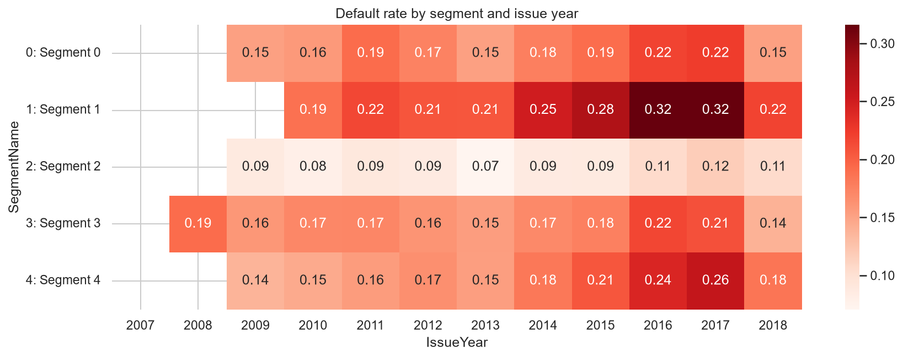

# Credit Portfolio Segmentation and Risk Pattern Analysis

An unsupervised machine learning project that segments 1.35 million resolved loans into borrower
groups, compares K-Means, Hierarchical clustering and DBSCAN, visualises the data with PCA, t-SNE
and UMAP, tests the segments against historical default rates, detects unusual borrower profiles,
and presents everything in an interactive Streamlit dashboard.



## Problem statement

A lender holds a large loan portfolio but cannot easily see natural borrower groups or how risk
differs between them. This project discovers borrower segments from borrower characteristics only,
then tests whether those segments differ in historical default rates.

**Default is never used to build the segments.** It is used afterwards, as an outside test.

## Business use cases

Credit risk segmentation, borrower profiling, loan product design, portfolio trend monitoring,
geographic portfolio analysis and anomaly detection.

## Dataset

- `loans_granting_model_dataset` (CSV). Not committed; place it at `data/raw/loans.csv`.
- 1,347,681 resolved loans issued from 2007 to 2018, of which 269,249 defaulted (20.0%).
- Variables used: annual income, debt-to-income ratio (DTI), loan amount, credit score,
  employment length, loan purpose, home ownership, state, issue date and the default flag.

## Quick start: run the dashboard only

The repository contains the saved models, summary tables and a 100,000-loan sample, so the
dashboard runs without the original dataset.

```bash
git clone https://github.com/meyogessh08/credit-portfolio-segmentation.git
cd credit-portfolio-segmentation
python -m venv .venv
.venv\Scripts\activate            # Windows PowerShell (macOS/Linux: source .venv/bin/activate)
pip install -r requirements.txt
streamlit run app/app.py
```

## Full reproduction

Requires Python 3.12 or newer (developed on 3.14). Exact library versions are in
`requirements-lock.txt`. All random seeds are set to 42.

1. Install as above and place the CSV at `data/raw/loans.csv`.
2. Run notebooks `01` to `10` in order (about 30 to 40 minutes; the t-SNE, UMAP and K-Means steps are
   the slowest). They write to `data/processed/`, `models/`, `docs/figures/` and `app_data/`.
3. Check that the dashboard places borrowers exactly like the notebooks: `python tests/test_segments.py`
4. Launch the dashboard: `streamlit run app/app.py`

## Approach

| Step | Notebook | What happens |
|---|---|---|
| 1 | `01_data_understanding` | Profile the data, find quality issues |
| 2 | `02_data_cleaning` | Keep the ten variables, define default, fix types and impossible values |
| 3 | `03_eda` | Distributions, default patterns, issue-year effects, correlations |
| 4 | `04_feature_engineering` | Reusable preprocessing pipeline and PCA |
| 5 | `05_embeddings` | PCA, t-SNE and UMAP maps |
| 6 | `06_kmeans` | Choosing k, stability, K-Means on all loans |
| 7 | `07_hierarchical_dbscan` | Dendrogram and DBSCAN on samples |
| 8 | `08_comparison_and_profiling` | Algorithm comparison, segment profiling and naming |
| 9 | `09_default_and_anomalies` | Default rates, significance tests, anomaly detection |
| 10 | `10_dashboard_data` | Small files that power the dashboard |

### Key design decisions

- **Only resolved loans** (fully paid or defaulted) are kept. Loans still being repaid have not had time
  to default, which would distort default rates. Recent issue years are still incomplete, so segments
  are compared within the same issue year.
- **Identifiers and the default flag are excluded** from the clustering features. State and issue year
  are used only to describe segments.
- **Impossible values:** DTI above 100 (533 loans, including the code 999) is treated as missing.
- **Preprocessing:** income and loan amount are log-transformed, extreme values are capped at the 1st and
  99th percentile, missing values are filled with the median, and everything is scaled. Loan purpose and
  home ownership are one-hot encoded (rare categories grouped) and weighted 0.5. The whole recipe is one
  saved pipeline, so new borrowers are treated exactly like the historical loans.
- **PCA** keeps 5 components (about 94% of the variance).
- **Sampling:** hierarchical clustering, DBSCAN, t-SNE, UMAP and silhouette run on random samples,
  because their memory and time grow with the square of the data (the distance matrix for all loans
  would need about 7 terabytes). K-Means runs on every loan.



## Results

### Borrower segments (K-Means, k = 5)

| Segment | Share | Typical borrower | Default rate |
|---|---|---|---|
| Prime credit | 11.6% | Credit score about 757 | 9.5% |
| Smaller loans, lower income | 21.8% | Income about 41k, loan about 5.7k | 18.4% |
| Established earners | 25.6% | Income about 88k, loan about 17.7k, 10 years employed | 19.2% |
| Higher income, short tenure | 19.8% | Income about 85k, loan about 17.5k, 2 years employed | 20.9% |
| Stretched (high debt-to-income) | 21.3% | DTI about 28.5, income about 51k | 27.5% |

The portfolio default rate is 20.0%.



### Evaluation metrics

| Metric | Result |
|---|---|
| Silhouette score | K-Means 0.175 and Hierarchical 0.121 on the same 5,000 borrowers; 0.14 to 0.19 across k = 2 to 12 |
| PCA explained variance | 4, 5 and 6 components for 80%, 90% and 95% of the variance; 5 kept |
| Cluster interpretability | Five segments, each describable in one sentence from its standardised profile |
| Default-rate comparison | 9.5% to 27.5% across segments (about 2.9 times); chi-square 21,362 (p near 0); Cramer's V 0.126 |
| Stability | Split-half agreement 0.95 for k = 5; seed agreement high with 10 starts |

### Algorithm comparison

Same 5,000 borrowers for K-Means and Hierarchical; DBSCAN on a 20,000 sample.

| Method | Clusters | Silhouette | Davies-Bouldin | Calinski-Harabasz | Notes |
|---|---|---|---|---|---|
| K-Means (k = 5) | 5 | 0.175 | 1.49 | 1,017 | Balanced segments; scales to all loans |
| Hierarchical, Ward (k = 5) | 5 | 0.121 | 1.74 | 755 | Uneven sizes; agreement with K-Means (ARI) 0.34 |
| DBSCAN | 1 large cluster plus noise | not defined | not defined | not defined | No density gaps, so used for anomaly detection |



### Dimensionality reduction

PCA, t-SNE and UMAP maps show a continuum of borrowers with smooth gradients (for example credit
score), not separate islands. UMAP suggests one mild split. The segments are therefore a useful
partition of a continuum, which is why they are judged on stability, interpretability and default
separation, not on clean separation alone.



### Default patterns

- Ranking is stable: the stretched segment has the highest default rate and the prime segment the lowest
  in every issue year.
- Adjusting for issue year changes segment rates by at most 0.9 points.
- The effect is real but modest (Cramer's V 0.126), and the middle three segments are within 2.5 points
  of each other. Segmentation is not a substitute for a supervised credit-scoring model.



### Anomaly detection

An Isolation Forest flags the most unusual 1% of loans (13,477), mostly very high credit scores combined
with small loans. They default less (12.5% against 20.1%) and are concentrated in the prime segment.
DBSCAN noise points overlap moderately with these flags. Loans with impossible DTI values are handled
separately as data-quality problems.

## Dashboard

Six tabs: **Overview**, **Segments**, **Default Patterns**, **Maps and Anomalies**,
**Place a Borrower** (assign a new borrower to a segment using the saved pipeline) and
**Method and Limits**. Sidebar filters cover segment, issue year, loan purpose, home ownership and state.

## Project structure

```
app/             Streamlit dashboard
src/             preprocessing pipeline, segment assignment, statistics helpers, config
tests/           checks that the dashboard places borrowers exactly like the notebooks
notebooks/       01-10 analysis notebooks
app_data/        small summary files and samples used by the dashboard
models/          saved pipeline, PCA, K-Means, Isolation Forest and result tables
docs/            data dictionary and figures
```

## Limitations

- Silhouette scores are low and the maps show a continuum, so the segments are not naturally separate
  groups. Different algorithms agree only moderately.
- Only resolved, approved loans are included; recent issue years are incomplete.
- Default rates describe groups historically. They are not causes and not predictions for any individual.
- Loan purpose and home ownership barely influence the segments; employment length splits borrowers by
  tenure but relates only weakly to default.
- Hierarchical clustering, DBSCAN, t-SNE and UMAP used samples because of memory limits.
- In the dashboard, a new borrower's profile is typed in; a real system would look it up.

## Ethical use

Segments describe groups of borrowers in a historical portfolio. They are not credit decisions about
individuals. State is shown for description only because it can act as a proxy for protected
characteristics, and no conclusion should be drawn about any individual from segment membership.

## Tech stack

Python, Pandas, NumPy, scikit-learn, SciPy, UMAP, Matplotlib, Seaborn, Plotly, Streamlit, joblib, ruff.

## Author

Yogesh PN
